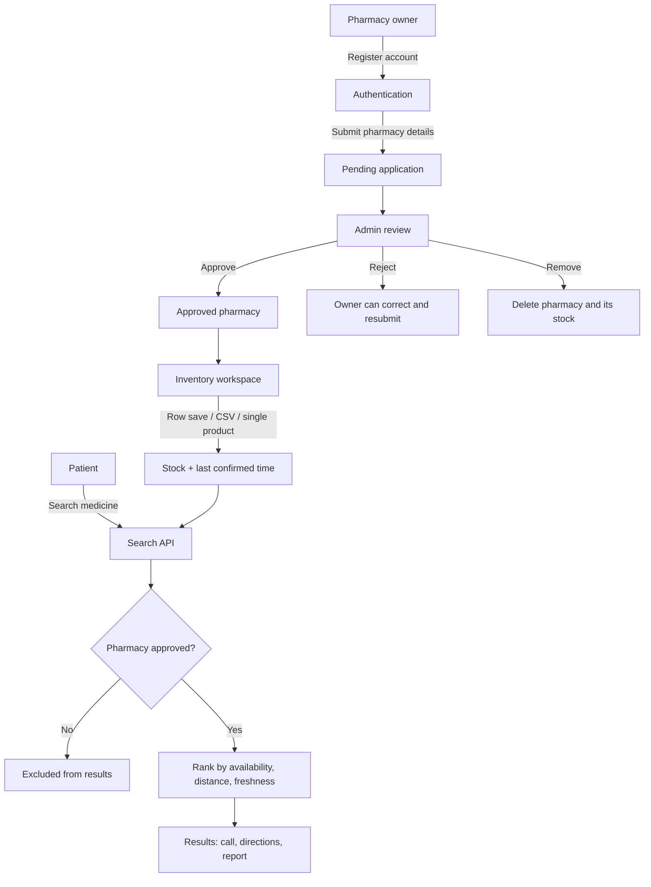
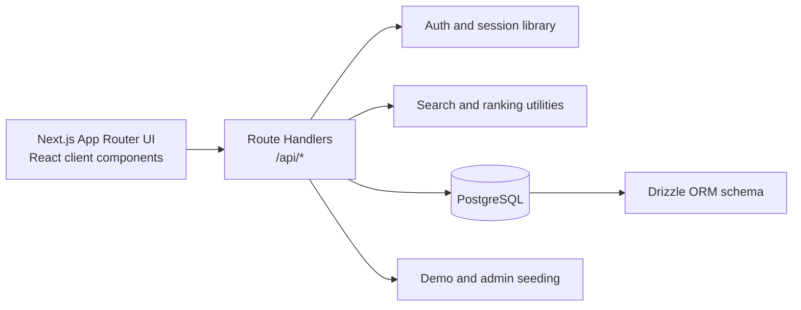
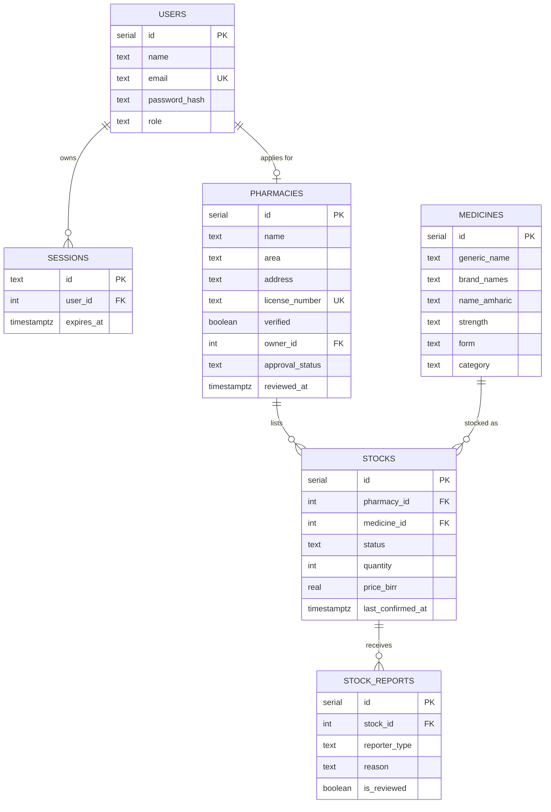

# MedFinder — Use-Case Demonstration & Project Defense

This guide explains the problem MedFinder addresses, how far that problem is being solved, how the solution works, and how to demonstrate it. It is written to support a project presentation, live demo, and question-and-answer defense.

---

## 1. One-line pitch

**MedFinder helps patients in Addis Ababa find which nearby, verified pharmacy has a medicine in stock — and shows how recently that information was confirmed — while giving pharmacy owners a simple way to keep availability current.**

---

## 2. Problem statement

### 2.1 The core problem

A patient usually knows the medicine they need, but not which nearby pharmacy currently has it. Pharmacy stock changes throughout the day, is rarely published, and is spread across phone calls, informal messages, and static directories. The result is repeated calls, unnecessary travel, delayed access, and low trust in whatever information is available.

The problem is therefore **information asymmetry at the point of search**, not a claim that medicines do not exist. MedFinder does not attempt to solve national medicine supply or logistics. It solves the last-mile question:

> *“Which nearby pharmacy can I call right now because it has this medicine, and how fresh is that information?”*

### 2.2 Who experiences the problem

| Actor | Pain today | What MedFinder changes |
| --- | --- | --- |
| Patients and caregivers | Call several pharmacies, travel without certainty, lose time and transport money | Search by generic name, brand, or a close spelling; compare distance, availability, and freshness |
| Pharmacy owners | Repetitive phone calls, missed walk-in sales, no simple digital channel | A lightweight workspace to confirm stock in rows, by CSV, or one product at a time |
| Administrators / pilot team | No visibility into which listings are trustworthy | An approval console to verify, approve, reject, revoke, or remove pharmacies |
| Health system / partners | Inefficient use of pharmacy capacity and patient time | Better-matched demand and a reusable availability data layer |

### 2.3 Why the problem persists

1. **Stock is volatile.** A static directory or social-media post is outdated within hours.
2. **Pharmacies have no low-effort publishing habit.** Any solution must fit an existing workflow.
3. **Unverified listings destroy trust.** A wrong listing is worse than no listing.
4. **Patients cannot judge freshness.** “Available” without a timestamp is not actionable.
5. **Existing maps answer location, not availability.** They show where a pharmacy is, not what it currently stocks.

### 2.4 Formal problem statement

> Patients in Addis Ababa lack a trustworthy, low-effort way to discover which nearby pharmacy currently has a specific medicine. Pharmacy-held stock information is fragmented, changes quickly, and is rarely verified or time-stamped, causing avoidable calls, travel, delay, and mistrust.

---

## 3. Extent of the problem (scope)

A defense is stronger when the scope is explicit. MedFinder is a **pilot**, not a national real-time inventory system. The table below states exactly what is in scope and what is not.

| Dimension | Extent in this project | Implication |
| --- | --- | --- |
| Geography | Addis Ababa pilot; 12 demo pharmacy profiles across Bole, Kazanchis, Piassa, Saris, Megenagna, Lideta, Arat Kilo, CMC, Mexico, Gerji, and Sar Bet | Proves the workflow in a realistic urban setting; not a multi-city rollout |
| Users | Three roles: patient (no account needed), pharmacy owner, administrator | Clear separation of visibility and control |
| Catalogue | 10 seeded medicines across diabetes, blood pressure, antibiotics, respiratory, pain, digestive health, hydration, and allergy; owners can add more | Demonstrates the flow without claiming a complete national formulary |
| Time | Availability is considered fresh for **24 hours**; older non-out-of-stock listings become “unconfirmed” | Balances honesty with the burden on pharmacy staff |
| Data source | Owner-confirmed stock, admin-approved pharmacy profiles, patient issue reports | Not connected to a pharmacy POS or national stock system |
| Functional scope | Search, distance ranking, freshness, owner inventory, approval lifecycle, issue reporting | No diagnosis, prescribing, payments, delivery, or medical advice |
| Evidence | End-to-end API and UI acceptance tests, TypeScript checks, and a working local deployment | Proves the flow works; it is not a prevalence study of medicine shortages |

### 3.1 What this project deliberately does **not** claim

- It does **not** guarantee that a medicine is physically on the shelf at the moment a patient arrives.
- It does **not** replace a phone call or a pharmacist’s professional judgment.
- It does **not** integrate with pharmacy point-of-sale systems in real time.
- It does **not** cover the whole of Ethiopia or the whole medicine catalogue.
- It does **not** provide diagnosis, dosage, prescription, or treatment advice.

Stating these boundaries is part of the solution: patients are told to call ahead, and stale information is visibly marked rather than presented as certain.

### 3.2 Why this extent is defensible

- **Narrow enough to be honest:** the product solves one decision — where to call or go next.
- **Broad enough to be useful:** it covers the full loop from owner update to patient search and admin moderation.
- **Measurable:** freshness, approval status, distance, and search success can all be observed in the demo.
- **Extensible:** the catalogue, pharmacy network, and integrations can grow without changing the core model.

---

## 4. Solution

### 4.1 Solution statement

> MedFinder is a verified, owner-maintained, freshness-aware availability layer. Pharmacy owners confirm stock through a simple workspace; an administrator approves the pharmacy before it becomes visible; patients search by medicine name and see nearby approved pharmacies ranked by availability, distance, and freshness, with a clear timestamp and a way to report incorrect information.

### 4.2 How the solution maps to the problem

| Problem | Mechanism in MedFinder | Where to see it |
| --- | --- | --- |
| Patients do not know who has stock | Medicine search across approved pharmacy stock | `/` patient search |
| Information is outdated | `last_confirmed_at` plus a 24-hour freshness window; stale items become “unconfirmed” | Result cards and inventory rows |
| Listings cannot be trusted | Admin approval gate; only approved pharmacies appear in search; verified flag | `/admin` and `/api/search` |
| Owners need a low-effort tool | Row-level save, “save all”, CSV import, and single-product add | `/pharmacy` |
| Patients cannot report errors | Anonymous issue reporting with predefined reasons | Result card “Report an issue” |
| Distance matters | Haversine distance and selectable radius (3, 5, 8, 12, 20 km) | Search controls and result ordering |
| Names vary | Generic, brand, Amharic, strength, and form matching with typo tolerance | Search suggestions and results |
| Access must be safe | Server-side role and ownership checks; scrypt passwords; hashed session tokens | API routes and auth library |

### 4.3 Key design decisions and rationale

1. **Owner-maintained data.** The pharmacy is closest to the truth, so it confirms stock rather than an administrator guessing on its behalf.
2. **Admin approval before visibility.** Trust is the product’s core value; an unverified listing would undermine it.
3. **Freshness over false precision.** A 24-hour window with an “unconfirmed” state is more honest than pretending stock is real-time.
4. **Two update paths.** CSV supports bulk updates; the single-product form supports quick additions. Adoption improves when both workflows exist.
5. **Distance plus availability ranking.** A close pharmacy with confirmed stock is more useful than a distant one with stale stock.
6. **Patient reports as a feedback loop.** Reports are stored for review, giving the pilot a signal when listings are wrong.
7. **Bilingual interface.** English and Amharic support make the pilot more accessible in Addis Ababa.
8. **No medical advice.** The product stays within availability information and explicitly tells patients to confirm and consult a professional.

---

## 5. System overview

### 5.1 Roles

- **Patient:** searches without an account; can call, get directions, and report an issue.
- **Normal user / pharmacy owner:** registers an account, applies for one pharmacy, and manages stock only after approval.
- **Administrator:** reviews applications, approves/rejects/revokes, and removes pharmacies.

### 5.2 Use-case flow

### 5.3 Architecture

### 5.4 Data model (simplified)

A unique constraint on `(pharmacy_id, medicine_id)` prevents duplicate stock rows, and the medicine identity index prevents duplicate name/strength/form combinations. One pharmacy per owner is enforced by the application layer; demo pharmacies have no owner.

---

## 6. Demonstration script

### 6.0 Before the demo

- Start PostgreSQL and run `npm run dev`; confirm `http://localhost:3000/api/health` returns `{"ok":true}`.
- Use a fresh browser window or incognito mode to avoid stale sessions.
- Admin login: `admin@medfinder.local` / `Admin123!` (also shown on the login page).
- Use a unique owner email and licence number for each run, for example `demo.owner.<timestamp>@example.com` and `DEMO-<timestamp>`.
- Do not delete or modify existing user-created pharmacies unless they are the ones created during the demo.

Suggested timing: 10–12 minutes.

### 6.1 Patient search (2 minutes)

1. Open `/`.
2. Search for **Metformin** and keep the default 8 km radius.
3. Point out the result cards: availability status, distance, last-confirmed time, call and directions actions.
4. Search for a brand such as **Ventolin** to show brand matching.
5. Search a typo such as **Metformn** to show the suggestion/typo-tolerant behavior.
6. Optionally use **Use my location** to show distance-based ordering.

**Expected result:** nearby approved pharmacies appear, ranked by availability and distance, with a freshness timestamp.

**Talking point:** the patient is not given a vague directory entry; they are given a time-stamped, actionable lead and told to call before travelling.

### 6.2 Report an issue (1 minute)

1. On a result card, choose **Report an issue**.
2. Select a reason such as “The pharmacy says this is out of stock”.
3. Send the report.

**Expected result:** a confirmation message; the report is stored anonymously for review.

**Talking point:** the feedback loop does not rely only on owners; patients can signal incorrect availability.

### 6.3 Owner registration and application (3 minutes)

1. Open `/register` and create a normal account.
2. Go to `/pharmacy`; the onboarding card appears because no pharmacy is linked.
3. Choose **Register your pharmacy**.
4. Enter a unique pharmacy name, licence number, area, address, phone, and hours.
5. Submit.

**Expected result:** an “Application submitted” screen; the workspace shows a **Pending review** card, and the inventory is not available.

**Talking point:** a normal user can become a pharmacy owner, but cannot manage stock or appear in patient search until an administrator approves the pharmacy.

### 6.4 Admin approval (2 minutes)

1. Sign out, then sign in as the administrator.
2. Open `/admin`.
3. Show the pending count and the new application with owner name, email, licence, area, and submission date.
4. Click **Approve**.

**Expected result:** a confirmation toast; the pharmacy moves to Approved; the pending count drops; the approved count rises.

**Talking point:** approval is the trust gate. Pending and rejected pharmacies are excluded from patient search by the search API.

### 6.5 Owner inventory: single product and CSV (2 minutes)

1. Sign out and sign back in as the owner.
2. Open `/pharmacy`; the approved workspace and inventory table are now visible.
3. Change one row (for example Metformin) to **In stock** with quantity 20 and click **Save**.
4. Click **Add product**, enter a new medicine such as “Azithromycin”, strength “250 mg”, form “Capsule”, category “Antibiotic”, availability “In stock”, quantity 15, and an optional price. Submit.
5. Optionally download the CSV template and import a small file with `medicine,status,quantity` columns.

**Expected result:** the row saves with “Just now”; the new product appears in the table with the chosen status and quantity; CSV import reports how many items were imported and how many rows were skipped.

**Talking point:** owners can update one item quickly or many items in bulk. Both paths write the same stock record and refresh the confirmation time.

### 6.6 Verify the patient loop (1 minute)

1. Open `/` in another tab or incognito window.
2. Search for the new product name (for example “Azithromycin”).
3. Confirm that the approved pharmacy now appears with fresh stock.

**Expected result:** the owner’s update is visible to patients immediately.

**Talking point:** this closes the loop: owner confirms → database updates → patient sees a fresh, verified result.

### 6.7 Admin removal (1 minute)

1. Sign in as the administrator and open `/admin`.
2. Find the demo pharmacy and click **Remove**; confirm the warning.
3. Return to patient search and search for the medicine again.

**Expected result:** the pharmacy disappears from the admin list and from patient search; its stock listings are deleted with it.

**Talking point:** moderation is not only approval; the administrator can remove a pharmacy that should no longer be listed.

### 6.8 Closing summary (30 seconds)

Restate the chain:

> Fragmented, stale stock information → verified owner-maintained listings → freshness-aware search → fewer unnecessary calls and trips → better use of pharmacy capacity and patient time.

---

## 7. Defense points

### 7.1 “The problem is real, but is it big enough to matter?”

**Answer:** The project targets a specific, recurring decision: where to call or go next. Even a modest reduction in failed pharmacy trips saves patient time, transport cost, and pharmacy call handling. The pilot is deliberately scoped to Addis Ababa and a representative catalogue so the workflow can be validated before scaling. The claim is not that MedFinder solves national supply; it is that it removes a costly information gap at the point of search.

**Evidence to point to:** the patient search flow, distance ranking, freshness labels, and the owner update loop.

### 7.2 “How do you know the extent of the problem?”

**Answer:** The project defines extent along explicit dimensions: geography (Addis Ababa pilot), users (patients, owners, admins), catalogue (10 seeded medicines, extensible), time (24-hour freshness), and data source (owner-confirmed, not POS-integrated). This prevents overclaiming. Broader prevalence would require field research; the pilot is designed to make that research possible by producing observable availability and freshness data.

**Evidence to point to:** Section 3’s scope table and the “what this project does not claim” list.

### 7.3 “Why not just use Google Maps or a static directory?”

**Answer:** Maps answer “where is a pharmacy?”, not “does it have this medicine now, and when was that confirmed?”. MedFinder combines medicine-level stock, owner confirmation, admin verification, freshness, and patient reports. It is a purpose-built availability layer rather than a location directory.

### 7.4 “How do you prevent fake or abandoned pharmacies?”

**Answer:** A pharmacy cannot appear in search until an administrator approves it. Approval sets the verified flag; rejection or revocation removes it from search. Administrators can also permanently remove a pharmacy, which cascades to its stock. Future work can add automated licence verification and periodic re-verification.

**Evidence to point to:** `/admin`, the approval API, and the search filter on `approval_status = 'approved'`.

### 7.5 “What if a pharmacy stops updating its stock?”

**Answer:** Listings older than 24 hours are shown as **unconfirmed** rather than “in stock”. Patients see the last-confirmed time and are told to call ahead. Owners can refresh a row in seconds; patients can report issues. This is an honest degradation strategy instead of pretending the data is always current.

**Evidence to point to:** `FRESHNESS_WINDOW_HOURS = 24`, the unconfirmed state, and the “Freshness matters” note.

### 7.6 “Is the solution technically secure?”

**Answer:** Passwords are hashed with Node’s `scrypt`; session tokens are random, stored only as SHA-256 hashes, and delivered in an HttpOnly, SameSite cookie with a seven-day expiry. Every sensitive route checks authentication, role, and ownership on the server. Inputs are validated and bounded. Patient search does not require an account and no patient health information is collected.

**Evidence to point to:** `src/lib/password.ts`, `src/lib/auth.ts`, and the authorization checks in the stock, pharmacy, and admin routes.

### 7.7 “Why this architecture and these choices?”

**Answer:** Next.js App Router keeps the patient, owner, and admin experiences in one deployable application. PostgreSQL provides relational integrity for users, pharmacies, medicines, stock, and reports. Drizzle gives a typed schema and safe queries. The stack is standard, portable, and inexpensive to run for a pilot.

### 7.8 “What are the limitations?”

**Answer:** Stock is owner-confirmed, not POS-integrated; updates are manual; the pilot covers one city and a small catalogue; there is no email verification, password reset, SMS/USSD channel, prescription workflow, or admin triage screen for patient reports yet. These are explicit future-work items, not hidden assumptions.

**Evidence to point to:** Section 9.

### 7.9 “How would you evaluate success?”

**Answer:** Acceptance criteria include: patients can find a medicine by generic, brand, or typo; only approved pharmacies appear; owners cannot edit before approval; admins can approve, reject, and remove; stock updates are immediately visible; stale stock is marked unconfirmed; CSV and single-product paths both work; and unauthorized access is rejected. The pilot also produces measurable signals such as search success, report volume, and freshness coverage.

---

## 8. Anticipated questions and answers

| Question | Short answer |
| --- | --- |
| Is the data real-time? | No. It is owner-confirmed with a 24-hour freshness window; stale items become “unconfirmed”. Real-time POS integration is future work. |
| Why 24 hours? | It balances honesty with the burden on pharmacy staff. The window is a single configurable constant. |
| Why require admin approval? | Trust is the core value; an unverified listing is worse than no listing. |
| What happens to a rejected application? | The owner sees the rejection and can correct the details and resubmit the same record. |
| Can one owner manage several pharmacies? | Not in this pilot; one pharmacy per owner simplifies ownership and approval. Multi-branch support is future work. |
| What happens when a pharmacy is deleted? | Its stock and related reports are removed by database cascade, and it disappears from search. |
| Do patients need an account? | No. Search, call, directions, and reporting work without an account. |
| Is patient health data stored? | No. Searches are not tied to an identity; reports are anonymous and contain only the stock reference and a reason. |
| What about prescriptions and advice? | Out of scope. The app states that it does not provide medical advice and that prescription medicines require a prescription. |
| Can owners add medicines not in the catalogue? | Yes, through the single-product form. The medicine is added to the shared catalogue and linked to that pharmacy’s stock. |
| What if a CSV has invalid rows? | Valid rows are imported; invalid rows are skipped and the count is reported. Bulk saves are limited to 100 updates per request. |
| How does search handle typos? | It normalizes names and uses Levenshtein-based similarity across generic, brand, Amharic, strength, and form, with suggestions when no match is found. |
| Why is distance ranking combined with availability? | A close pharmacy with confirmed stock is more actionable than a distant one with stale stock. |
| How would this scale? | Indexes, radius filtering, and a 60-result cap support the pilot; PostGIS, caching, and read replicas are natural next steps. |
| What is the business model? | Not implemented in the pilot. Options include pharmacy subscriptions, verification services, or partnerships; the focus here is validating the workflow. |

---

## 9. Limitations and future work

| Limitation | Why it exists | Future direction |
| --- | --- | --- |
| Manual stock updates | No POS integration in the pilot | POS/API integration, scheduled imports, or pharmacy-system connectors |
| No real-time guarantee | Stock changes faster than manual confirmation | Event-driven updates and shorter freshness windows for integrated pharmacies |
| One city, small catalogue | Pilot scope | Multi-city rollout and a broader, curated formulary |
| No SMS/USSD/offline channel | Web-first pilot | SMS/USSD, lightweight PWA, and a phone hotline for low-connectivity users |
| Reports are stored but not triaged in the UI | Time-boxed pilot | Admin report queue, triage states, and automatic listing review |
| No email verification or password reset | Pilot authentication scope | Email verification, password reset, and optional two-factor authentication |
| Shared medicine catalogue | Owner-created products join the network catalogue | Admin moderation of new medicines and richer duplicate detection |
| No prescription or clinical workflow | Safety boundary | Keep availability-only; integrate with licensed clinical services if ever expanded |
| Single owner per pharmacy | Simplifies ownership | Pharmacy staff accounts and multi-branch ownership |

---

## 10. Evaluation and acceptance evidence

The following checks were executed during development:

| Check | Result |
| --- | --- |
| TypeScript compilation (`npm run typecheck`) | Passed |
| Patient search returns approved pharmacies only | Passed |
| Normal user registration and session handling | Passed |
| Owner application creates a pending pharmacy | Passed |
| Pending owner cannot update stock | Passed |
| Non-admin cannot access admin APIs | Passed |
| Admin approval makes the pharmacy visible | Passed |
| Approved owner can update stock | Passed |
| New product is searchable by patients | Passed |
| Admin deletion removes the pharmacy from search | Passed |
| CSV import and single-product add | Passed in API and UI checks |
| Unauthenticated and cross-owner requests are rejected | Passed |

These are functional acceptance checks, not a statistical evaluation of medicine availability.

---

## 11. Closing statement

MedFinder does not claim to fix the entire medicine supply chain. It fixes a narrower but expensive problem: patients cannot easily tell which nearby pharmacy has their medicine, and pharmacies have no simple, trusted way to say so. By combining owner-maintained stock, administrator verification, explicit freshness, distance-aware search, and patient feedback, the pilot turns fragmented information into an actionable, time-stamped lead — and it does so within a scope that is honest, testable, and extensible.

---

## Appendix A — Demo data snapshot

**Seeded pharmacies (12):** Bole 01, Bole 02, Kazanchis, Piassa, Saris, Megenagna, Lideta, Arat Kilo, CMC, Mexico, Gerji, Sar Bet.

**Seeded medicines (10):**

| Medicine | Strength / form | Category |
| --- | --- | --- |
| Metformin | 500 mg tablet | Diabetes |
| Amlodipine | 5 mg tablet | Heart & blood pressure |
| Amoxicillin | 500 mg capsule | Antibiotic |
| Salbutamol | 100 mcg inhaler | Respiratory |
| Losartan | 50 mg tablet | Heart & blood pressure |
| Insulin glargine | 100 IU/ml injection | Diabetes |
| Paracetamol | 500 mg tablet | Pain relief |
| Omeprazole | 20 mg capsule | Digestive health |
| Oral rehydration salts | 20.5 g sachet | Hydration |
| Cetirizine | 10 mg tablet | Allergy |

**Administrator:** `admin@medfinder.local` / `Admin123!`

Demo data and the administrator are seeded on the first request. A `demo_seeded` marker prevents deleted demo pharmacies from being recreated on restart.

---

## Appendix B — API map

| Endpoint | Method | Access | Purpose |
| --- | --- | --- | --- |
| `/api/search` | GET | Public | Medicine search with distance, radius, freshness, and ranking |
| `/api/reports` | POST | Public | Report an availability issue |
| `/api/auth/register` | POST | Public | Create a normal user account |
| `/api/auth/login` | POST | Public | Sign in and create a session |
| `/api/auth/logout` | POST | Signed in | Revoke the session |
| `/api/auth/me` | GET | Signed in | Return the current user |
| `/api/pharmacy/register` | POST | Signed in | Submit or resubmit a pharmacy application |
| `/api/pharmacy` | GET | Signed in | Load the owner/admin workspace |
| `/api/stock` | PATCH | Owner or admin | Bulk or row-level stock updates |
| `/api/stock/product` | POST | Owner or admin | Add one product at a time |
| `/api/admin/pharmacies` | GET | Admin | List pharmacies and approval statistics |
| `/api/admin/pharmacies/[id]` | PATCH | Admin | Approve, reject, or revoke |
| `/api/admin/pharmacies/[id]` | DELETE | Admin | Remove a pharmacy and its stock |
| `/api/health` | GET | Public | Readiness check |

---

## Appendix C — Suggested demo checklist

- [ ] PostgreSQL running and `/api/health` returns `ok`
- [ ] Admin login verified
- [ ] Fresh browser/incognito window
- [ ] Unique owner email and licence number prepared
- [ ] Patient search, typo suggestion, and report demonstrated
- [ ] Owner registration and pending state demonstrated
- [ ] Admin approval demonstrated
- [ ] Row save, single product, and CSV demonstrated
- [ ] Patient search confirms the new stock
- [ ] Admin removal demonstrated and explained
- [ ] Problem, scope, solution, and limitations summarized
